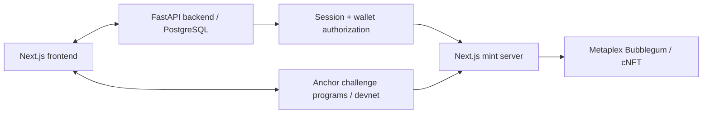

# SolBreach

**Practice finding and fixing Solana security bugs by exploiting vulnerable programs.**

[Beta](https://beta.solbreach.com) · [Website](https://solbreach.com) · [Documentation](https://solbreach.gitbook.io/documentation) · [Backend](https://github.com/jpromano-swe/solbreach-backend) · [Re-submission checklist and video scripts](SUBMISSION.md)

Solana builders can read about missing account checks without learning to spot them
in a transaction. SolBreach gives them a concrete task: inspect a vulnerable program,
construct an exploit, verify its impact, and explain the fix.

## What's new since Frontier

The **2026-10-12 re-submission patch** hardens certificate mint authorization,
restricts global initialization to the program upgrade authority, replaces public
solver entrypoints with learner templates, and corrects product claims and setup docs.
See [CHANGELOG.md](CHANGELOG.md) for dated repository evidence. Earlier beta, backend,
landing and cNFT milestones are listed separately; their dates must not be presented
as new work without comparing against the actual Frontier submission baseline.

Demo video and pitch video: **pending recording/public links**. Use the scripts and
checklist in [SUBMISSION.md](SUBMISSION.md); a live beta link does not replace a video.

## How it works

1. Open the beta, complete beta access/onboarding, and connect a devnet wallet.
2. Read a challenge and inspect its account relationships.
3. Construct an attempt and sign the devnet transaction.
4. Call the level's `verify_and_close` instruction after meeting its objective.
5. Inspect the transaction in Explorer and claim a completion certificate.

The repository includes a warmup and three vulnerability modules: account
substitution, shared PDA authority, and arbitrary CPI. Research Labs additionally
provide an inspection, impact-verification and finding-report workflow. Lab runtime
verification and public devnet execution are distinct; a modeled lab result is not
a devnet transaction. Breach Rooms are **roadmap / prototype**, not a shipped assessment product.

## How Solana is used

The Anchor challenge program stores player progression and certificate accounts in
PDAs. The `mercenary` program is an intentionally vulnerable-training CPI helper.
The server mints completion cNFTs through Metaplex Bubblegum on devnet.



| Program                          | Devnet address                                                                                                                                  |
| -------------------------------- | ----------------------------------------------------------------------------------------------------------------------------------------------- |
| Challenge / certificate registry | [aVf7hEpHmn7L5ZPBhtu13apZREM7VdwFKzSJ9yNovf2](https://explorer.solana.com/address/aVf7hEpHmn7L5ZPBhtu13apZREM7VdwFKzSJ9yNovf2?cluster=devnet)   |
| Mercenary CPI helper             | [EYUQDYesXVQon3tfQavDu5gErk4oGnNmVXnQHDnCHzzv](https://explorer.solana.com/address/EYUQDYesXVQon3tfQavDu5gErk4oGnNmVXnQHDnCHzzv?cluster=devnet) |

Addresses come from the source configuration. An updated local build does not imply
that these deployed programs already contain the re-submission patch.

## Run locally

Requirements: Node.js 20+, npm, a running [backend](https://github.com/jpromano-swe/solbreach-backend),
and a devnet wallet. Rust, Solana CLI and Anchor 0.32.1 are needed for program tests.

```bash
npm ci
cp .env.example .env.local
npm run dev
```

Set `NEXT_PUBLIC_API_BASE_URL` and `SOLBREACH_BACKEND_URL` to your backend. For minting,
configure server-only `SOLANA_RPC_URL`, `MERKLE_TREE_ADDRESS`, `ADMIN_PRIVATE_KEY`
and `APP_BASE_URL`. Never use `NEXT_PUBLIC_` variables for secrets. The RPC must return
the devnet genesis hash. The client cannot override the RPC or Merkle tree.

Apply backend migration `202610120001` before deploying this frontend. Every level
requires a backend session bound to the recipient wallet and a signed mint message.
Messages expire after five minutes, are single-use, and have a persisted limit of
five attempts per wallet per ten minutes. Failed mint attempts consume authorization;
retry by signing a new message. Completion is checked separately using backend state
or a valid program-owned certificate PDA.

```bash
npm run test:security
npm run build
npm run lint
npm run anchor-build
npm run codama:js
npm run anchor-test
```

## Security boundaries and evidence

The missing mint check, shared profile PDA and unchecked CPI target are intentional
challenge vulnerabilities. Global bank/guild/certificate initialization is not a
challenge: only the upgrade authority may initialize it. See [anchor/README.md](anchor/README.md).
The existing global profile behavior remains part of Level 2.

LiteSVM tests validate program behavior. The backend also contains an optional RL1
LiteSVM adapter and deterministic lab runtimes; neither is a general uploaded-code
verification service. Completion credentials record observed completion, not proof
of unaided work or professional auditing ability. Public Git history and regression
tests can reveal challenge solutions even after removing the solver CLI.

No interview count, workshop date, paid customer count, or institutional partnership
is claimed here without published supporting evidence. See [SUBMISSION.md](SUBMISSION.md).

Built by [Juan Pablo Romano](https://github.com/jpromano-swe), Buenos Aires, Argentina.
