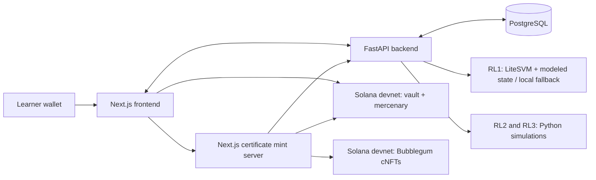

<p align="center">
  
</p>

# **Security Training Layer for Solana builders.**

[Try the beta](https://beta.solbreach.com) · [Pitch](https://youtu.be/4CunhIXPDro) · [Demo](https://youtu.be/kPHk-jrA4Xk) · [Website](https://solbreach.com) · [Documentation](https://solbreach.gitbook.io/documentation) · [Backend](https://github.com/jpromano-swe/solbreach-backend/tree/backend-testing)

SolBreach is for builders who already understand Rust, Anchor, Solana accounts,
PDAs, and token accounts, and want to recognize security failures in practice.
Learners connect vulnerable account relationships to protocol impact, then document
the root cause, evidence, and mitigation in an audit-style report.

## Try it

1. Open [beta.solbreach.com](https://beta.solbreach.com) and request beta access or
   redeem an invitation code. The project currently documents `COLOSSEUM-BETA` as a beta
   code; availability depends on the access service.
2. Complete onboarding and connect a Solana wallet configured for **devnet**.
3. Start with the warmup and guided vulnerability modules, then investigate a Research Lab.
4. Review the resulting state and evidence, complete the finding report, and claim
   an eligible completion certificate.

Use devnet SOL and test assets for the intentionally vulnerable challenges.
The videos show the product flow; the runtime table below identifies which parts
execute on devnet and which run in a backend sandbox or simulation.

## Current product and execution environments

This inventory describes the source reviewed on **2026-10-12**. The product branches
are [research-labs-frontend](https://github.com/jpromano-swe/solbreach/tree/research-labs-frontend)
and [backend-testing](https://github.com/jpromano-swe/solbreach-backend/tree/backend-testing).
They are the starting points for this setup; source availability does not establish
which revision is deployed to the beta or to devnet.

| Experience                                       | What the learner practices                                   | Where it runs / current scope                                                                                                                                           |
| ------------------------------------------------ | ------------------------------------------------------------ | ----------------------------------------------------------------------------------------------------------------------------------------------------------------------- |
| Level 0 — Hello SolBreach                        | Wallet, player PDA, and transaction lifecycle                | Anchor `vault` program on devnet; progression warmup.                                                                                                                   |
| Level 1 — The Illusionist                        | Missing mint checks and account substitution                 | Anchor `vault` program on devnet, with frontend and backend learning flows.                                                                                             |
| Level 2 — The Identity Thief                     | Shared PDA state and missing authority checks                | Anchor `vault` program on devnet, with frontend and backend learning flows.                                                                                             |
| Level 3 — The Trojan Horse                       | Arbitrary CPI and forwarded signer privileges                | Anchor `vault` and `mercenary` programs on devnet, with frontend and backend learning flows.                                                                            |
| RL1 — Account Substitution                       | Counterfeit collateral, protocol credit, and treasury impact | Backend LiteSVM adapter with modeled state adjustments and a local simulation fallback; see the qualification below.                                                    |
| RL2 — Yield Hijack                               | Static PDA collisions and reward-claim authority             | Guided Python simulation of protocol state and account changes.                                                                                                         |
| RL3 — Arbitrary CPI                              | Unchecked CPI target and delegated payout authority          | Guided Python simulation, including the displayed build, deploy, and CPI steps.                                                                                         |
| Breach Rooms                                     | Less-guided protocol review and finding submission           | Frontend prototype for a GitHub PR review workflow; its backend routes are absent from the reviewed backend checkout.                                                   |

**RL1 is a hybrid runtime.** The backend selects its LiteSVM adapter when importable
and falls back to the local runtime on `ImportError`. The adapter loads a program
and submits transactions, but also adjusts account state directly and can turn
failed deposit/withdraw transactions into modeled successful transitions. An RL1
success result alone therefore does not prove successful SVM program execution.
RL2 and RL3 use their Python runtimes even when the LiteSVM adapter is selected.

Research Lab transaction references, balances, and the in-app explorer describe
session evidence. They are not public devnet transactions. Completing a secure-pattern
exercise explains a mitigation; it does not yet prove that a learner's patched
program was compiled and passed an exploit regression test.

### Reports and Breach Room review

Research Labs combine account inspection, constrained exploit actions, impact checks,
finding-review questions, and a structured report builder. The backend evaluates
answers and report fields against predefined rules and verified session evidence.
This is deterministic assessment, not an independent audit or expert review.

The Breach Rooms interface is designed to submit a finding package, link a GitHub
PR, and display a review decision and comments. Its displayed workflow describes
SolBreach team review and a GitHub webhook recording the PR outcome. The reviewed
backend does not contain that integration, so this repository does not establish
an operational review service or autonomous agent review.

## How Solana is used

The Anchor `vault` program implements levels 0–3, player progression, and certificate
PDAs. The `mercenary` program is the intentionally vulnerable-training CPI helper.
The Next.js server mints completion **compressed NFTs (cNFTs)** through Metaplex
Bubblegum on devnet after wallet authorization and the relevant completion checks.
The FastAPI backend stores learning sessions, reports, XP, badges, and certificate metadata.



| Program                                       | Devnet address                                                                                                                                  |
| --------------------------------------------- | ----------------------------------------------------------------------------------------------------------------------------------------------- |
| `vault` — challenges and certificate registry | [aVf7hEpHmn7L5ZPBhtu13apZREM7VdwFKzSJ9yNovf2](https://explorer.solana.com/address/aVf7hEpHmn7L5ZPBhtu13apZREM7VdwFKzSJ9yNovf2?cluster=devnet)   |
| `mercenary` — CPI helper                      | [EYUQDYesXVQon3tfQavDu5gErk4oGnNmVXnQHDnCHzzv](https://explorer.solana.com/address/EYUQDYesXVQon3tfQavDu5gErk4oGnNmVXnQHDnCHzzv?cluster=devnet) |

These addresses match the program declarations in this repository. A local commit
does not upgrade the deployed programs. To inspect a completed challenge, open its
actual transaction in Solana Explorer with `cluster=devnet`; use the mint transaction
and asset ID returned by the certificate flow to inspect the cNFT.

## Who pays

The proposed model keeps introductory learning free for developers and sells
**licenses per cohort** to bootcamps, accelerators, hackathons, and developer education
teams. Custom labs and Breach Rooms are potential additional offerings. Pricing
and willingness to pay remain to be validated through a paid pilot; these are
business plans, not claims of existing customers or revenue.

The next validation milestone is a measured cohort pilot: track completion by module,
time to completion, learner return, report quality, and willingness to pay. Interview
and beta-participant counts are not published here without a reconciled supporting dataset.

## Repository map

| Path                                                                                         | Purpose                                                                                |
| -------------------------------------------------------------------------------------------- | -------------------------------------------------------------------------------------- |
| [`app/components/`](app/components/)                                                         | Guided modules, Research Lab workspaces, reports, profile, and Breach Rooms interface. |
| [`app/lib/`](app/lib/)                                                                       | Wallet, backend, progression, and certificate integration.                             |
| [`app/api/nfts/certifications/`](app/api/nfts/certifications/)                               | Server routes for certificate minting and metadata.                                    |
| [`anchor/programs/`](anchor/programs/)                                                       | `vault` and `mercenary` Rust programs and program regression tests.                    |
| [`app/generated/vault/`](app/generated/vault/)                                               | Generated Anchor client.                                                               |
| [`scripts/`](scripts/)                                                                       | Maintainer tooling for certificate infrastructure and minting.                         |
| [`tests/`](tests/)                                                                           | Frontend end-to-end and certificate authorization checks.                              |
| [Backend repository](https://github.com/jpromano-swe/solbreach-backend/tree/backend-testing) | FastAPI service, database migrations, Research Lab runtimes, and templates.            |

## Run locally

Requirements: Node.js **20.9+**, npm, a running [backend](https://github.com/jpromano-swe/solbreach-backend/tree/backend-testing),
and a devnet wallet. Rust, the Solana CLI, and Anchor **0.32.1** are additionally
needed to build and test the on-chain programs.

```bash
git clone --branch research-labs-frontend https://github.com/jpromano-swe/solbreach.git
cd solbreach
npm ci
cp .env.example .env.local
npm run dev
```

Open `http://localhost:3000`. Configure the variables from [`.env.example`](.env.example):

| Variable                   | Purpose                                                                                                               |
| -------------------------- | --------------------------------------------------------------------------------------------------------------------- |
| `NEXT_PUBLIC_API_BASE_URL` | Browser-facing backend URL; locally `http://localhost:8000`.                                                          |
| `SOLBREACH_BACKEND_URL`    | Backend URL reachable by the Next.js mint server.                                                                     |
| `APP_BASE_URL`             | Public frontend origin used for certificate metadata URLs. Use a reachable hosted origin for wallet-visible metadata. |
| `SOLANA_RPC_URL`           | Server-side devnet RPC used for minting.                                                                              |
| `MERKLE_TREE_ADDRESS`      | Configured Bubblegum Merkle tree for certificates.                                                                    |
| `ADMIN_PRIVATE_KEY`        | Server-only mint authority secret key as a JSON array.                                                                |

Minting requires a configured tree and authority; starting the frontend does not
provision them. Keep secrets out of `NEXT_PUBLIC_` variables and Git. The mint server
checks the devnet genesis hash and owns RPC/tree configuration.

Certificate minting requires a backend session linked to the recipient wallet and a signed authorization
message. Messages expire after five minutes, are single-use, and have a persisted
limit of five attempts per wallet per ten minutes. A failed mint consumes its
authorization; retry with a new signed message. Completion is checked separately
using the relevant backend state or a valid program-owned certificate PDA.

### Development checks

```bash
npm run test:security
npm run build
npm run lint
npm run anchor-build
npm run codama:js
npm run anchor-test
```

The security suite uses mocked backend/RPC responses; it does not prove a live mint.
Build the programs before running the Rust LiteSVM tests. See [anchor/README.md](anchor/README.md)
for program setup and administrative boundaries.

## Recent source changes and next steps

The **2026-10-12 source patch** adds wallet-bound, single-use certificate authorization,
server-controlled devnet mint configuration, and upgrade-authority checks for global
initialization. See [CHANGELOG.md](CHANGELOG.md) for dated source evidence and earlier
milestones. Deployment of that patch must be verified separately. Comparing changes
“since Frontier” also requires the actual prior submission baseline.

Next technical milestones are reproducible program execution for the modeled lab
paths, compiled patch verification with exploit regression tests, and completing the
backend integration for advanced modules and Breach Rooms. Submission follow-up is
tracked in [SUBMISSION.md](SUBMISSION.md).

The missing mint constraint, shared profile PDA, and unchecked CPI target are
intentional challenge vulnerabilities. Completion credentials record observed
completion; they do not establish unaided work or professional auditing ability.

Built by [Juan Pablo Romano](https://github.com/jpromano-swe), Buenos Aires, Argentina.

